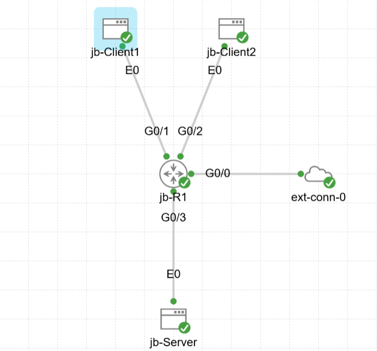
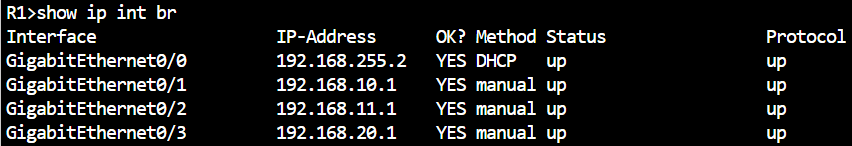
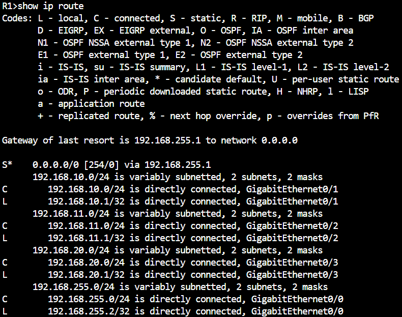
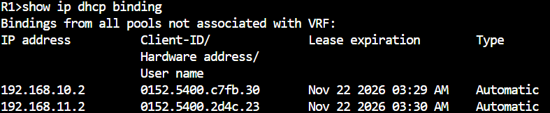
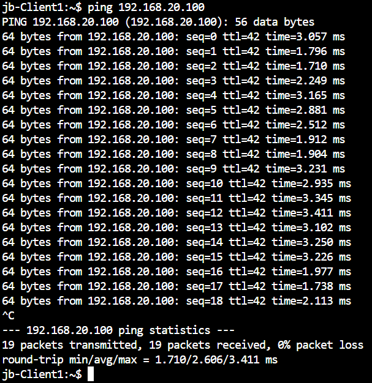
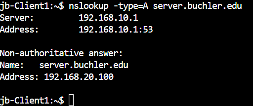
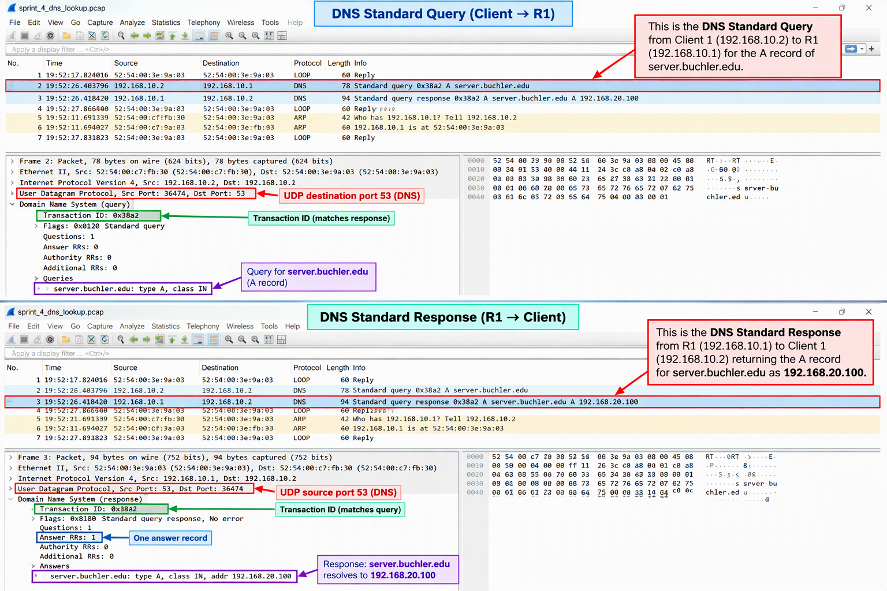

# Sprint 4 Network Verification Report

## Network Topology

*Figure 1. `jb-Client1`, `jb-Client2`, and `jb-Server` connect to `jb-R1` on G0/1, G0/2, and G0/3, respectively. The external connector connects on G0/0.*

## Router CLI Outputs

### `show ip int br`

*Figure 2. All four interfaces on `jb-R1` show `up/up`: G0/0 at `192.168.255.2`, G0/1 at `192.168.10.1`, G0/2 at `192.168.11.1`, and G0/3 at `192.168.20.1`.*

### `show ip route`

*Figure 3. The routing table on `jb-R1` shows connected routes for `192.168.10.0/24`, `192.168.11.0/24`, `192.168.20.0/24`, and `192.168.255.0/24`, plus a default route through `192.168.255.1`.*

### `show ip dhcp binding`

*Figure 4. Two automatic DHCP bindings on `jb-R1`: `192.168.10.2` and `192.168.11.2`.*

## Client Command Logs

### `ping 192.168.20.100`

*Figure 5. Ping from `jb-Client1` to `192.168.20.100`: 19 packets transmitted and 19 received, with 0% packet loss and an average round-trip time of `2.606 ms`.*

### `nslookup -type=A server.buchler.edu`

*Figure 6. The DNS server at `192.168.10.1` returns `192.168.20.100` for the A-record lookup of `server.buchler.edu`.*

## Annotated Wireshark DNS Exchange

*Figure 7. DNS exchange between `jb-Client1` and `jb-R1`. Frame 2 queries the A record for `server.buchler.edu` from `192.168.10.2:36474` to `192.168.10.1:53`. Frame 3 returns `192.168.20.100`. Both use transaction ID `0x38a2`; the response contains one answer and no DNS error.*
